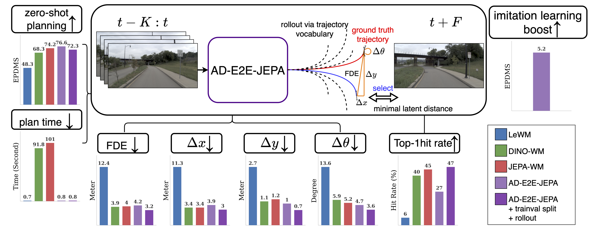

<h1 align="center">
    <p><b>AD-E2E-JEPA: A Joint-Embedding Predictive Architecture for End-to-End Autonomous Driving</b></p>
</h1>

<div align="center" style="line-height: 1;">
  <a href="https://arxiv.org/abs/2609.34085" target="_blank" style="margin: 2px;"></a>
  <a href="https://huggingface.co/HaoranZhu/AD-E2E-JEPA" target="_blank" style="margin: 2px;">
  
  </a>
</div>

<br>

<p align="center">
  Haoran Zhu,
  Wancong Zhang,
  Yann LeCun,
  Anna Choromanska
</p>

<p align="center">
  New York University, AMI Labs
</p>



**Timeline:**
- [x] Paper released on 09/28/2026
- [x] Main source code released by 10/19/2026
- [x] Collect and upload model weights to Hugging Face by 10/23/2026
- [ ] Review community feedback, fix bugs if needed, and refactor the codebase by 11/19/2026

## 0) Execution Environment

The provided training and evaluation launchers are configured for GPU clusters managed by Slurm. The `.sbatch` scripts specify resource requests, environment setup, and filesystem paths. Adjust these settings to match your environment.

For standalone GPU servers, adapt the commands in these scripts into `.sh` launchers. We are testing standalone-server configurations and plan to provide updated instructions in the next release.

## 1) Installation

See the [Installation Guide](docs/INSTALL.md).

## 2) Training

See the [Training Guide](docs/TRAIN.md).

## 3) Goal-Conditioned Zero-Shot Planning

See the [Goal-Conditioned Zero-Shot Planning Evaluation Guide](docs/GCZSP_EVAL.md).

## 4) Training Downstream Imitation Learning Agent

See the [Downstream Imitation Learning Guide](docs/TRAIN_DOWNSTREAM.md).

## 5) Evaluating Downstream Imitation Learning Agent

See the [Downstream Imitation Learning Evaluation Guide](docs/DT_EVAL.md).

## 6) Pre-trained Checkpoints

Pre-trained checkpoints for the experiments above are available at [Hugging Face](https://huggingface.co/HaoranZhu/AD-E2E-JEPA).

## 7) Citation

```bibtex
@article{zhu2026ad,
  title={AD-E2E-JEPA: A Joint-Embedding Predictive Architecture For End-to-End Autonomous Driving},
  author={Zhu, Haoran and Zhang, Wancong and LeCun, Yann and Choromanska, Anna},
  journal={arXiv preprint arXiv:2609.34085},
  year={2026}
}
```
